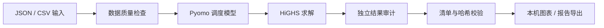

<!--
GridWise Campus README
Keep capability and release claims aligned with the code and verification evidence.
-->

<div align="center">

# ⚡ GridWise Campus

### 高校智慧能源管理系统 · Campus Energy Management System

**让校园能源分析更清晰，让每一次调度都可解释、可复核。**  
*An offline-first prototype for explainable campus energy analysis and battery-grid dispatch optimization.*

[](https://www.python.org/)
[](LICENSE)
[](https://www.microsoft.com/windows)
[](https://github.com/2257005148-jpg/GridWise-Campus/stargazers)
[](https://github.com/2257005148-jpg/GridWise-Campus/issues)

[快速开始](#quick-start) · [核心能力](#features) · [技术架构](#tech-stack) · [项目边界](#project-scope) · [参与贡献](#contributing)

</div>

---

## 项目简介 · Overview

**GridWise Campus** 是一个面向高校场景的离线能源分析与优化原型。它围绕校园负荷、光伏、电网购电与电池储能，提供多时段调度优化、数据质量检查、无储能基线对比、运行结果审计和本机可视化。

GridWise Campus is an **offline energy-analysis and optimization prototype** for campus scenarios. It explores multi-period dispatch across campus demand, photovoltaic generation, grid imports, and battery storage, with data-quality checks, baseline comparisons, run verification, and local visualization.

> **重要边界 / Scope:** 当前项目不连接真实校园系统、不控制现场设备，也不声称已具备生产部署或行业认证能力。请使用合成数据或经授权的本地数据。

<a id="features"></a>\n## ✨ 核心能力 · Key Features

| 能力 | 说明 |
|---|---|
| ⚡ 多时段优化 | 使用 Pyomo 建模，并通过 HiGHS 求解器进行光伏、电网与储能调度优化。 |
| 📊 策略对比 | 支持纯电费优化、显式峰值上限策略，以及同输入无储能基线。 |
| 🔎 数据质量检查 | 检查 JSON/CSV 输入、单位、时间间隔、缺失值与时间完整性。 |
| 🧾 可复核运行 | 运行目录包含清单与哈希；读取结果前执行完整性验证和独立审计。 |
| 🖥️ 双语桌面原型 | Tkinter/ttk 本机界面，支持数据检查、运行对比、历史记录与图表。 |
| 📤 报告与导出 | 导出 JSON、CSV、SVG，以及自包含 HTML 报告。 |
| 🧩 场景管理 | 支持本地设备参数配置、场景预设，以及经过校验的预设导入/导出。 |

## 🧭 工作流程 · Workflow



项目将输入校验、优化求解、独立审计、运行产物发布和安全读取分层处理。界面只展示通过校验的结果；数据完整性、策略公平性和指标变化是不同的判断，不应混为一谈。

<a id="quick-start"></a>\n## 🚀 快速开始 · Quick Start

### 环境要求

- Windows 11 或 Windows Server
- Python **3.12 或更高版本**
- 桌面界面需要可用的 Tk 图形环境

### 1. 获取源码

```powershell
git clone https://github.com/2257005148-jpg/GridWise-Campus.git
cd GridWise-Campus
```

### 2. 创建环境并安装

```powershell
python --version
python -m venv .venv
& .\.venv\Scripts\python.exe -m pip install -e .
```

参与开发或运行测试时，再安装测试依赖：

```powershell
& .\.venv\Scripts\python.exe -m pip install -e '.[test]'
```

### 3. 运行示例

```powershell
# 启动桌面原型
& .\.venv\Scripts\python.exe -m gridwise.desktop

# 运行 JSON 示例
& .\.venv\Scripts\python.exe -m gridwise.cli examples\synthetic-day.json outputs\sample

# 检查 CSV 示例
& .\.venv\Scripts\python.exe -m gridwise.data examples\synthetic-day.csv --step-hours 1
```

运行输出写入本地 `outputs/` 目录（该目录已被 Git 忽略）。示例数据为合成数据；桌面原型也允许用户主动选择本地 CSV。

## 🧪 测试 · Testing

项目使用严格 pytest Marker。每个测试必须且只能有一个主分类：`unit`、`gui` 或 `integration`；`solver`、`audit` 和 `slow` 用于标记更高风险或耗时的测试层。

日常安全检查：

```powershell
& .\.venv\Scripts\python.exe -m pytest --collect-only -q
& .\.venv\Scripts\python.exe -m pytest -q -m "(unit or integration) and not solver and not audit and not slow"
& .\.venv\Scripts\python.exe -m pytest -q -m "gui and not solver and not audit and not slow"
```

不要把 `solver`、`audit` 或 `slow` 测试当作普通安全测试随意执行；运行这些测试需要维护者明确授权、隔离环境和合成数据。完整测试状态请以对应提交的 GitHub Actions 记录为准。

<a id="tech-stack"></a>\n## 🏗️ 技术架构 · Tech Stack

- **语言：** Python 3.12+
- **优化：** Pyomo + HiGHS
- **桌面界面：** Tkinter / ttk
- **数据：** JSON、CSV
- **报告：** UTF-8 HTML、内联 SVG
- **验证：** pytest、独立审计、运行清单与 SHA-256 校验

## 📚 文档 · Documentation

| 文档 | 内容 |
|---|---|
| [桌面界面设计](docs/v0.3-desktop-design.md) | 桌面工作台结构与交互设计 |
| [运行目录契约](docs/run-artifact-contract.md) | 运行产物发布、清单与验证规则 |
| [运行历史保存](docs/run-history-storage.md) | 本地运行历史的保存与管理 |
| [自定义 CSV 导入](docs/custom-csv-import.md) | CSV 格式、校验与限制 |
| [设备参数配置](docs/custom-device-parameters.md) | 电网与电池参数配置 |
| [场景预设交换](docs/scenario-preset-exchange.md) | 场景预设 JSON 导入与导出 |
| [历史运行对比](docs/run-comparison.md) | A/B 公平对比条件 |
| [HTML 报告导出](docs/report-export.md) | 自包含报告生成与安全边界 |
| [运行诊断](docs/run-diagnostics.md) | 结构化诊断信息 |
| [导出一致性设计](docs/export-consistency-design.md) | 导出过程与一致性限制 |

## 🛡️ 安全与隐私 · Security & Privacy

- 请勿提交密码、API Key、Token、私钥、个人目录或真实校园敏感数据。
- 报告 Bug 时请优先使用合成数据，并在上传日志或截图前清理个人信息。
- 尚未修复的安全漏洞请勿通过公开 Issue 或 Pull Request 披露。
- 安全问题请阅读 [SECURITY.md](SECURITY.md)，并通过其中的私下联系渠道报告。

<a id="project-scope"></a>\n## 🗺️ 项目状态与边界 · Status & Scope

GridWise Campus 仍处于开发中的 **Alpha 离线原型**。当前包版本为 `0.1.0`；`v0.3.x` 是内部开发阶段编号，不代表正式软件发行版本。

以下能力不在当前已完成范围内：

- 真实校园能源系统接入
- 生产环境部署与运行保障
- 对现场电气设备的实时控制
- 负荷预测或完整配电网仿真
- 经认证的工程设计或节能效果保证

未来是否支持这些方向，需要独立设计、授权和验证。不要将本项目的示例优化结果直接作为真实校园运行决策。

<a id="contributing"></a>\n## 🤝 参与贡献 · Contributing

欢迎提交 Bug、功能建议和改进方案：

1. 先搜索现有 [Issues](https://github.com/2257005148-jpg/GridWise-Campus/issues)，避免重复。
2. 新建 Issue 时选择 Bug Report 或 Feature Request 模板。
3. 提交代码前阅读 [CONTRIBUTING.md](CONTRIBUTING.md)。
4. Pull Request 请说明改动、验证方式、已知限制及兼容性影响。

安全漏洞请遵循 [SECURITY.md](SECURITY.md)，不要公开发布未修复漏洞细节。

## 📄 许可证 · License

项目自有源代码采用 [Apache License 2.0](LICENSE)。第三方依赖仍受各自许可证约束；版本、归属、发行边界和未决事项见 [THIRD_PARTY_NOTICES.md](THIRD_PARTY_NOTICES.md)。

## 📬 联系 · Contact

项目联系与安全问题私下报告：

**smartcampusenergy@outlook.com**

<div align="center">

**GridWise Campus**  
*Smarter energy analysis. More transparent decisions.*

[GitHub 仓库](https://github.com/2257005148-jpg/GridWise-Campus) · [提交 Issue](https://github.com/2257005148-jpg/GridWise-Campus/issues) · [查看贡献指南](CONTRIBUTING.md)

</div>
