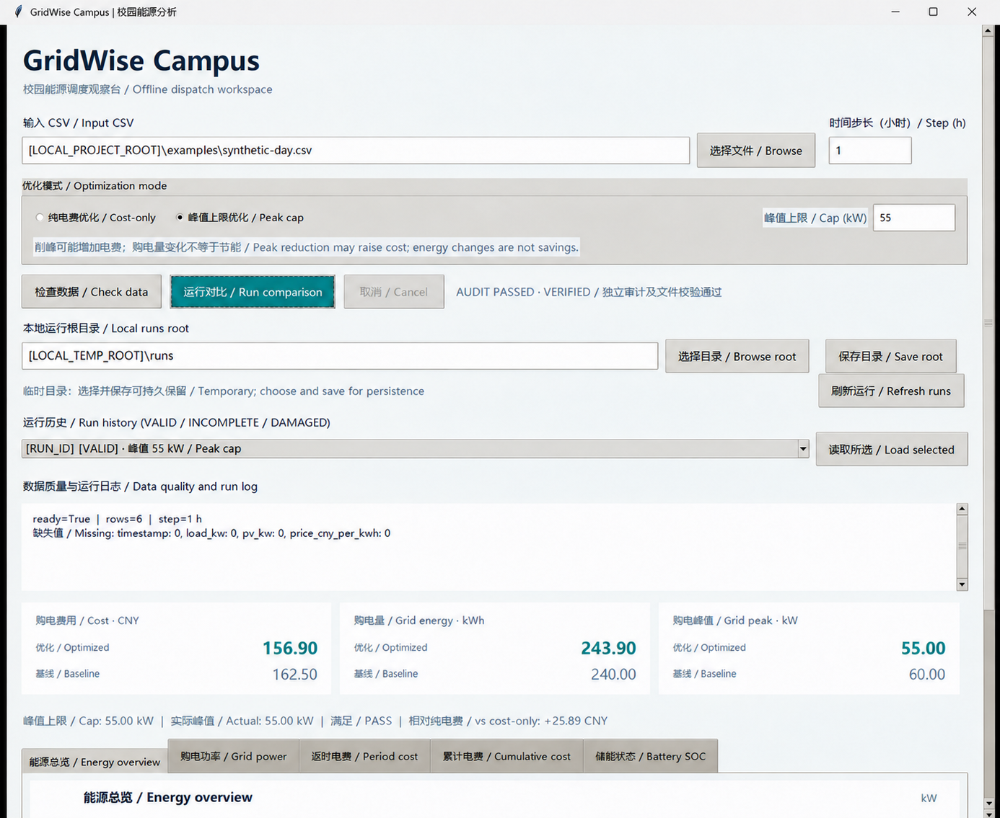

# GridWise Campus v0.3.12 阶段报告 / Desktop Peak-cap Stage Report

日期 / Date: 2026-10-26
仓库 / Repository: `[LOCAL_PROJECT_ROOT]`

## 1. 阶段目标与完成情况 / Objective and status

**已完成（动态验证）/ Completed and dynamically verified**

- 桌面端默认保持纯电费优化；用户可显式选择峰值上限模式并输入 kW 上限。
- 非数字、空值、NaN、Infinity、负数、超过界面软件边界或场景 `grid_max_kw` 的值明确失败，不启动成功发布流程。
- 复用既有后台线程、取消、关闭等待、代次隔离、独立审计、不可变运行目录和安全读取链路；Tk 控件仍只由主线程更新。
- 已校验运行的模式和上限进入桌面结果、历史列表及重启恢复流程；模式变化立即清除旧指标和图表。
- 峰值模式显示上限、实际峰值和达标状态；仅当存在同场景指纹、同求解器、同模型源码摘要、重新安全读取并与当前 CSV 对齐的纯电费运行时显示成本差额。
- 55 kW 合成场景经真实求解、独立审计、运行清单校验和桌面展示通过。

**静态审查 / Static review**

- v0.3.12 未修改 `src/gridwise/core.py`、`src/gridwise/data.py`、`tools/audit_exports.py` 或 `tools/audit_history.py`；工作区中前三者的既有差异来自进入本阶段前尚未提交的 v0.3.11 削峰实现。
- 未新增依赖、数据库、网络服务、设备接口或第二个 Tk 根解释器。
- UI 不计算电费、购电量或峰值公式；指标继续来自 `prepare_visualization_data`。

## 2. 新增和修改文件 / Files changed

本阶段文件 / v0.3.12 files:

- `src/gridwise/dashboard.py`：向既有运行控制链传递上限；从安全读取结果恢复策略元数据；限定可比较的纯电费参考运行。
- `src/gridwise/desktop.py`：模式单选、峰值输入、策略状态、历史标签、验证和失败关闭展示。
- `tests/test_dashboard.py`：控制层参数、发布元数据、历史恢复、可信成本参考和场景上界测试。
- `tests/test_desktop_ui.py`：GUI 输入验证、55 kW 结果、0 kW 不可行、历史重启恢复和源 CSV 不变测试。
- `tools/smoke_desktop_verified.py`：成本模式→峰值模式→历史读取→错误输入→重启恢复的桌面烟测，以及人工观察入口。
- `README.md`、`docs/architecture.md`、`docs/interface-spec.md`、`docs/test-plan.md`、`docs/v0.3-desktop-design.md`：同步双语行为、边界和测试说明。
- `docs/progress/assets/v0.3.12-peak-cap-gui.png`：仅含合成数据的 Windows GUI 实际运行截图。
- 本报告。

进入本阶段前已存在且保留的 v0.3.11 工作区差异 / Pre-existing v0.3.11 changes retained: `docs/data-dictionary.md`, `docs/math-model.md`, `docs/run-artifact-contract.md`, `src/gridwise/cli.py`, `src/gridwise/core.py`, `src/gridwise/run_artifacts.py`, `tests/test_core.py`, `tools/audit_exports.py`, `tests/test_peak_cap.py`, `docs/progress/2026-10-26-v0.3.11-peak-cap.md`，以及与 v0.3.12 共同更新的 README/接口/测试计划文件中的 v0.3.11 段落。未覆盖、撤销或单独暂存这些内容。

## 3. 关键实现与设计决策 / Key decisions

- 默认值为 `cost`；只有显式选择 `peak_cap` 才把 `peak_cap_kw` 传给既有模型入口。
- GUI 先拒绝明显非法值；控制层再按场景 `grid_max_kw` 校验。不可行模型仍由既有求解/发布契约失败关闭，不生成 `COMPLETE` 成功记录。
- `DashboardResult` 和 `RunHistoryEntry` 增加带默认值的策略字段，保留旧调用兼容性。
- 成本差额不是硬编码，也不以任意旧运行作比较。参考运行必须通过安全读取、场景 SHA-256、求解器、模型源码摘要和当前 CSV 对齐检查；缺证据时显示“无同输入有效对照”。
- 基线不施加 55 kW 上限。三项指标独立展示；削峰可能增加电费，购电量变化不等于节能。
- 切换策略会使当前结果失效并增加运行代次，避免后台旧结果覆盖新选择。

## 4. 测试驱动证据 / Test-first evidence

下列失败发生于相应实现之前，之后同一目标转绿：

| 测试 | 修复前证据 | 修复后 |
|---|---|---|
| 控制层传入峰值上限 | `TypeError: run_comparison() got an unexpected keyword argument 'peak_cap_kw'`，退出码 1 | 1 passed，退出码 0 |
| 历史策略元数据 | `RunHistoryEntry` 缺少 `optimization_mode`，退出码 1 | 1 passed，退出码 0 |
| 同输入纯电费参考 | 期望 131.0110803324，实际 `None`，退出码 1 | 1 passed，退出码 0 |
| GUI 模式与参数 | `EnergyDesktop` 缺少 `optimization_mode`，退出码 1 | 1 passed，退出码 0 |

没有删除负向测试、放宽原审计容差或跳过失败用例。

## 5. 实际命令与退出码 / Commands and exit codes

| 类型 | 命令 | 退出码 | 结果 |
|---|---|---:|---|
| 定向回归 | `python -m pytest -q tests/test_dashboard.py tests/test_desktop_ui.py tests/test_peak_cap.py tests/test_run_artifacts.py` | 0 | 103 passed，0 failed，0 skipped，137.89 s |
| 完整回归 | `python -m pytest -q` | 0 | 343 passed，0 failed，1 skipped，290.85 s |
| 跳过原因复核 | `python -m pytest -q -rs tests/test_cli_output_safety.py` | 0 | 18 passed，1 skipped，4.91 s；Windows `WinError 1314` 无符号链接创建权限 |
| 桌面完整烟测 | `python tools\smoke_desktop_verified.py` | 0 | 成本运行、55 kW 运行、历史读取、非法 CSV 拦截、输入哈希不变、重启恢复全部通过 |
| 成本运行独立审计 | `python tools\audit_exports.py [LOCAL_TEMP_ROOT]\[LOCAL_TEMP_ENTRY]\runs\[RUN_ID]\scenario.json [LOCAL_TEMP_ROOT]\[LOCAL_TEMP_ENTRY]\runs\[RUN_ID]\optimized.csv [LOCAL_TEMP_ROOT]\[LOCAL_TEMP_ENTRY]\runs\[RUN_ID]\baseline.csv [LOCAL_TEMP_ROOT]\[LOCAL_TEMP_ENTRY]\runs\[RUN_ID]\summary.json` | 0 | `AUDIT PASSED` |
| 峰值运行独立审计 | `python tools\audit_exports.py [LOCAL_TEMP_ROOT]\[LOCAL_TEMP_ENTRY]\runs\[RUN_ID]\scenario.json [LOCAL_TEMP_ROOT]\[LOCAL_TEMP_ENTRY]\runs\[RUN_ID]\optimized.csv [LOCAL_TEMP_ROOT]\[LOCAL_TEMP_ENTRY]\runs\[RUN_ID]\baseline.csv [LOCAL_TEMP_ROOT]\[LOCAL_TEMP_ENTRY]\runs\[RUN_ID]\summary.json` | 0 | `AUDIT PASSED` |
| 安全读取 | `python -m gridwise.run_artifacts verify [LOCAL_TEMP_ROOT]\[LOCAL_TEMP_ENTRY]\runs\[RUN_ID]` | 0 | 清单格式 2、`peak_cap`、55 kW 元数据验证通过 |

独立验收根目录为 `[LOCAL_TEMP_ROOT]\[LOCAL_TEMP_ENTRY]`。原合成 CSV 的 SHA-256 在验收前后均为 `0A964EF1432DB1006E82B59270C824A663C55110EC1836B9A68C4E8F94EE2061`。

## 6. GUI 动态验证与截图 / GUI verification

Windows 上实际创建并刷新 Tk 窗口，完成成本模式和 55 kW 模式真实求解、审计、显示及历史恢复。截图通过窗口自身离屏捕获，避免其他窗口遮挡；预览进程已退出，`[LOCAL_TEMP_ENTRY]*` 临时目录无残留。

截图显示：峰值模式、55 kW 输入、`AUDIT PASSED · VERIFIED`、成本/购电量/峰值双方案指标、`Actual: 55.00 kW`、`PASS` 和 `+25.89 CNY`。这是程序化桌面烟测和视觉检查证据，不等同于人工物理键盘、屏幕阅读器或跨显示器 DPI 验收。

## 7. 关键数值及依据 / Numerical results and basis

相同合成输入、1 小时时步、同一电价、同一基线和 `peak_grid_kw = max(grid_kw)` 口径：

| 方案 | 电费 CNY | 购电量 kWh | 峰值 kW |
|---|---:|---:|---:|
| 纯电费优化 | 131.01108033240996 | 247.02216066481995 | 90.0 |
| 55 kW 峰值上限优化 | 156.9 | 243.9 | 55.0 |
| 无储能基线 | 162.5 | 240.0 | 60.0 |

- 峰值模式相对纯电费模式：电费 **+25.888919667590045 CNY**，购电量 **-3.122160664819944 kWh**，峰值 **-35 kW**。
- 峰值模式相对无储能基线：电费 **-5.6 CNY**，购电量 **+3.9 kWh**，峰值 **-5 kW**。
- 两种运行均由现有图表准备层重算指标，导出由独立审计器复核；这些结果不证明输入真实性、跨场景收益或长期节能。

## 8. 未解决问题、风险与 NOT_RUN / Risks and unexecuted items

- `NOT_RUN`：Linux、macOS、托管 CI、真实校园数据或设备、屏幕阅读器、人工物理键盘完整遍历、原生多显示器 DPI 切换、长时间耐久测试。
- Tk/Tcl 历史间歇性焦点/资源读取异常本阶段未针对根因调查，状态仍为 `UNKNOWN`；未声称 Quota Float 卸载已修复问题。
- Windows 符号链接负向测试因当前令牌缺少创建权限而跳过；不是通过。
- 可信成本参考依赖本地历史中存在兼容运行；缺失时明确不显示差额。
- `1e12` 是 GUI 防止异常数值 token 的软件边界；实际场景上界仍是更严格的 `grid_max_kw`。
- 项目正式许可证仍未确定；未发布、未上传、未连接外部服务。

## 9. Git 状态 / Git status

- 起始及报告生成前 HEAD：`65d334947e61455f1ac6ad814cab3eae8423b58d`，分支 `master`。
- 本阶段没有暂存、提交、推送或配置远程。
- 工作区同时保留尚未提交的 v0.3.11 与 v0.3.12 文件；必须在未来提交前按阶段和归属逐项审查，不能使用 `git add -A`。
- `git diff --check`：退出码 0；`git diff --cached --check`：退出码 0；暂存文件列表为空。
- v0.3.12 文本文件常见凭据模式扫描：0 命中；截图大小 69,218 bytes。
- 五份 v0.1 至 v0.1.4 历史报告继续保持未跟踪且未修改，最终 SHA-256 复核为：
  - `v0.1-baseline`: `77B5444A210CA23BADD2B6BFB91DB23E61C85B0C0473E6C617C867BAB17B9223`
  - `v0.1.1-audit`: `4633D8B869484D7D1C2CBC7865411CD1DDD4564F037B656E45E6F499B2DE4F7D`
  - `v0.1.2-robustness`: `86D7AF96DC36363723D1C52A9B65A2E4C050AF99FBB263314F6E7B779741DC7C`
  - `v0.1.3-portability-performance`: `6A927BE251F9A56B9B92736464FDF24290113227561AF6CB7C2800455E4E4275`
  - `v0.1.4-traceability-validation`: `AEFB94C50274D28BAB868EE63A740FDEEE59DA84963D5FA5849513F6C937593C`

## 10. 下一阶段建议 / Next recommendation

先由维护者审阅 v0.3.11 与 v0.3.12 的组合差异。若授权提交，应显式列出文件、再次运行 `git diff --check`、核对五份历史报告哈希并检查暂存清单；不要把历史未跟踪报告纳入提交。后续可单独开展 Tk/Tcl 根因捕获和人工可访问性验收，不应与削峰模型语义混合。
